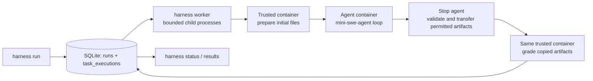

# Agentic Eval Harness

Run mini-swe-agent against the supplied bash and Python benchmarks through one
CLI. Runs are queued in SQLite, local workers execute tasks in isolated Docker
containers, and results remain available after the processes exit.

Supports all five **bash-operations** tasks and all three **python-tasks**.
mini-swe-agent is a Git submodule pinned to **v1.17.5**
(`68d367bf0ccf40ad59a07101a94c21b66e7798ff`).

## Architecture



The CLI handles submission and presentation. `db.py` owns atomic claims and
persistence; `worker.py` bounds concurrent execution and handles recovery.
`execution.py` runs one task through the small `Agent` and `Benchmark` protocols.
No database lock is held during Docker or model execution.

## Quick start

Requires Git, uv, and a running Docker daemon. Workers require a POSIX system
(macOS or Linux) and a dedicated, single-threaded process. uv installs Python
3.11 below; the project supports Python 3.11+.

```bash
git clone --recurse-submodules https://github.com/aashnijoshi/agentic-eval-harness.git
cd agentic-eval-harness
git submodule update --init --recursive
uv python install 3.11
uv sync --locked
uv run harness --help

# Make the trusted bash grader's pinned base available locally.
docker pull python@sha256:b7a9e5f6a93d6d4a31f129bbd4bdee69efccb6ded0fb230d78aafaf37af98377

docker build -f docker/mini.Dockerfile -t harness-mini:python .
docker build -f docker/mini.Dockerfile \
  --build-arg BASE_IMAGE=alpine:latest@sha256:be2656061b536c1883c4034790e21d0a09c5aaaf51968b89368a3c0371ea2c9a \
  -t harness-mini:alpine .
```

The Dockerfile keeps the declared image families: Python slim for Python tasks
and Alpine/musl for bash tasks, with Python and Bash installed into Alpine.
Both runtimes use the lockfile and pinned uv image. Builds exclude host
credentials, environments, benchmark data, and Git metadata.

## Usage

Every command accepts `--db PATH` (default `harness.sqlite3` in the current
directory). Use the same path for submission, workers, status, and results.
Use an absolute path when working from different directories.

### Offline demonstration

These scripted responses run the real mini agent loop and supplied graders,
with no API key, paid calls, or container networking. The dedicated demo
database keeps this example separate from any live runs.

```bash
RUN_ID=$(uv run harness run --db demo.sqlite3 \
  --agent agents/mini-swe-agent --benchmark bash-operations \
  --task_ids bash-001,bash-002 --replay tests/fixtures/task_responses.json)

uv run harness status --db demo.sqlite3 --run_id "$RUN_ID"
uv run harness worker --db demo.sqlite3 --concurrency 2 --drain
uv run harness results --db demo.sqlite3 --run_id "$RUN_ID" --format summary
uv run harness results --db demo.sqlite3 --run_id "$RUN_ID" --format table
uv run harness results --db demo.sqlite3 --run_id "$RUN_ID" --format json
```

`run` validates and commits the submission, prints only the run ID, and exits
without executing tasks. Use one ID, comma-separated IDs, or omit `--task_ids`
to select every task. For example:

```bash
uv run harness run --db demo.sqlite3 --agent agents/mini-swe-agent \
  --benchmark bash-operations --replay tests/fixtures/task_responses.json
uv run harness run --db demo.sqlite3 --agent agents/mini-swe-agent \
  --benchmark python-tasks --replay tests/fixtures/task_responses.json
uv run harness worker --db demo.sqlite3 --concurrency 2 --drain
```

Omit `--drain` to keep a worker serving new submissions in a separate terminal.
Ctrl+C or SIGTERM stops new work and interrupts active tasks. Unclaimed tasks
remain queued. `--shutdown-timeout` controls the cleanup grace period (10 seconds
by default). A second coordinator for the same database is rejected.

`status` returns JSON counts, task states, timestamps, and finished/total
progress; `--run_id` is required. A run is running if any task is active,
otherwise queued if work remains. After all tasks finish, error takes
precedence over timed_out, then interrupted, then completed. An incorrect
solution is completed with `passed=false`, separately counted as a failed grade.

All result formats show outcomes, scores, accuracy, graded accuracy, errors,
durations, and available model calls/cost. JSON also includes diagnostics.
Overall accuracy is passed / selected tasks; graded accuracy is passed / valid
grades, or null if no grades exist. Pending tasks have null outcomes, not failed
grades. Usage totals stay null if any selected task lacks a measurement;
available per-task values remain visible. Duration is cumulative recorded task
time, not wall time or queue waiting time.

Successful submission, inspection, and worker shutdown return exit code 0.
Invalid input, missing runs, and coordinator failures return nonzero. Inspect
results to determine benchmark success; a worker does not exit unsuccessfully
merely because a task received a failed grade.

### Live models

Live execution is implemented but has not been tested against a provider.
Set the named credential securely in the **worker's environment**; do not put
its value in arguments or repository files. Submission does not require the key.

```bash
# Replace PROVIDER/MODEL with an available model; this queues a potentially paid run.
uv run harness run --db live.sqlite3 --agent agents/mini-swe-agent \
  --benchmark bash-operations --task_ids bash-001 \
  --model PROVIDER/MODEL --api-key-env OPENAI_API_KEY
uv run harness worker --db live.sqlite3 --concurrency 2 --drain
```

Use the credential variable appropriate to the provider, such as
`ANTHROPIC_API_KEY`. Only its name is stored in SQLite; the worker forwards the
value by environment name and redacts known credential values from diagnostics.
`--timeout` (60 seconds), `--step-limit` (20), and `--cost-limit` ($1) configure
each task. Cost checks occur between model calls, so one call can exceed the cap.

## Design decisions and failure handling

- **Isolation:** each task gets fresh agent and trusted containers, separate
  filesystems, resource limits, no host workspace mounts, and dropped
  capabilities. Replay networking is disabled.
- **Trusted grading:** benchmark definitions, graders, and Python tests stay
  outside the agent container. After the agent stops, only declared artifacts
  enter grading. Paths, links, file types, and artifact sizes are checked.
  The supplied scoring rules and grader exit-code conventions are preserved.
- **Durability:** two SQLite tables hold runs and task executions. Submission
  inserts all task rows atomically. `BEGIN IMMEDIATE` serializes claims;
  completion checks the running state, task ID, worker ID, and unique claim token.
- **Concurrency:** bounded, one-task child processes each open their own
  connection. An OS lock in `<database>.worker.lock` is inherited by children,
  preventing a replacement coordinator from bypassing the limit after a crash.
  Never delete the lock file or move/replace a database while workers run.
- **Recovery:** stopped workers are identified by PID and process nonce.
  Cleanup matches both durable execution ID and claim-token Docker labels.
  After verified exit and cleanup, the active claim is completed as interrupted.
  A live/reused PID or unavailable cleanup blocks recovery; age never requeues work.

There are no automatic task retries. SQLite cannot guarantee exactly-once
external effects: a paid model call may succeed before its answer is persisted.
Recovery records interruption rather than making another potentially paid call.
Daemon failures and in-flight Docker requests can require manual reconciliation
using the `agentic-harness.execution` and `agentic-harness.claim` labels.

## Adding an agent or benchmark

`models.py` defines the contracts; the supplied adapters show their use:

- An **Agent** supplies `image_for(task)`, `run(container, task) -> AgentResult`,
  `network`, and credential values for diagnostic redaction (`secrets`).
- A **Benchmark** supplies `task_ids()`, `load_task(task_id)`,
  `prepare(container, task)`, `evaluate(container, task) -> Grade`, and
  `grader_image`. Normalize dataset fields and
  preparation/grading arguments inside the adapter. Declare permitted artifacts
  in `Task` and preserve the grader's actual scoring contract.

Register new identifiers in submission validation and worker reconstruction,
and update CLI choices where applicable. Add a runtime image/mapping if needed.
Selection is explicit; there is no automatic plugin discovery. The current
benchmarks have binary grades; partial-credit benchmarks need corresponding
grade-validation changes.

Benchmark-specific instructions remain in
[bash-operations](benchmarks/bash-operations/README.md) and
[python-tasks](benchmarks/python-tasks/README.md).

## Testing and limitations

```bash
uv run pytest tests -q                         # No Docker or paid APIs required.
RUN_DOCKER_TESTS=1 uv run pytest tests -q        # Includes Docker and full async CLI.
```

Tests cover all eight correct and incorrect deterministic submissions, durable
queue behavior, actual process concurrency, interruption, stale ownership,
cleanup, and the public asynchronous workflow.

Verified on macOS ARM64 with Linux ARM64 Docker containers and Python 3.11.
Windows, other architectures, and live model providers are unverified.
Use a local filesystem, one machine, a dedicated single-threaded worker process,
and the same Docker context across restarts. Hard-linked database paths are
rejected. The concurrency limit covers this queue, not independent executions.

The submodule, base images, uv runtime image, and Python dependencies are pinned.
Alpine package repositories can change system packages; preserve built image
digests for exact runtime reproduction. Workers reference the local checkout
and replay files, so retain those files unchanged for queued runs. There is no
database migration or retention system.

The Python grader executes submitted code and is not hardened against hostile
code manipulating pytest inside the grading process. Hiding tests during agent
execution does not make that grader adversarially secure. Free-form artifacts
and diagnostics may contain sensitive task data; keep the ignored SQLite files
and results private.
