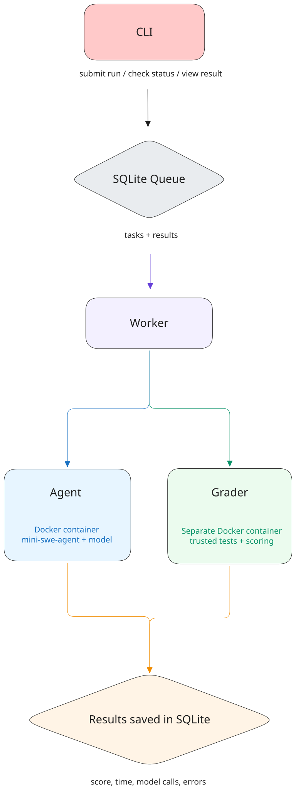

# One Agent, Eight Tasks

A small harness for running [mini-swe-agent](https://github.com/SWE-agent/mini-swe-agent) on two different benchmarks and seeing how it actually performs.

The idea is pretty simple: pick a benchmark, queue some tasks, let the agent work through them, and check what passed. Each task runs in Docker, grading happens separately, and results are saved in SQLite so you can come back to them later.

There are **8 tasks** across two benchmarks:

- **bash-operations:** 5 shell-based tasks
- **python-tasks:** 3 Python coding tasks

You can run everything offline with scripted agent responses, or connect a real model to see what happens.

## 1. Getting set up

You'll need **Git, [uv](https://docs.astral.sh/uv/), and a running Docker daemon** on macOS or Linux. The worker uses POSIX processes.

Clone the repo and install dependencies:

```bash
git clone --recurse-submodules https://github.com/aashnijoshi/agentic-eval-harness.git
cd agentic-eval-harness

# Also works if you cloned without --recurse-submodules
git submodule update --init --recursive
uv python install 3.11
uv sync --locked
```

Build the two agent images and make the trusted bash grader image available:

```bash
docker pull python@sha256:b7a9e5f6a93d6d4a31f129bbd4bdee69efccb6ded0fb230d78aafaf37af98377

docker build -f docker/mini.Dockerfile -t harness-mini:python .

docker build -f docker/mini.Dockerfile \
  --build-arg BASE_IMAGE=alpine:latest@sha256:be2656061b536c1883c4034790e21d0a09c5aaaf51968b89368a3c0371ea2c9a \
  -t harness-mini:alpine .
```

That's the setup! No API key is needed for the offline demo.

## 2. Try it out

Let's run two bash tasks first. This uses saved model responses, so there's no API cost.

```bash
RUN_ID=$(uv run harness run \
  --db demo.sqlite3 \
  --agent agents/mini-swe-agent \
  --benchmark bash-operations \
  --task_ids bash-001,bash-002 \
  --replay tests/fixtures/task_responses.json)

echo "$RUN_ID"
```

The tasks are now queued, but haven't run yet. Start a worker:

```bash
uv run harness worker \
  --db demo.sqlite3 \
  --concurrency 2 \
  --drain
```

Then check what happened:

```bash
uv run harness results \
  --db demo.sqlite3 \
  --run_id "$RUN_ID" \
  --format table
```

A few useful variations:

| Want to... | Use |
|---|---|
| Check progress | `uv run harness status --db demo.sqlite3 --run_id "$RUN_ID"` |
| Get a quick score summary | `uv run harness results --db demo.sqlite3 --run_id "$RUN_ID" --format summary` |
| See full agent messages and grader output | `uv run harness results --db demo.sqlite3 --run_id "$RUN_ID" --format json` |
| Run all five bash tasks | Omit `--task_ids` |
| Try the Python benchmark | Use `--benchmark python-tasks` with `--task_ids py-001`, or omit task IDs for all three |

Use the **same `--db` path** across commands. That's where the queue and results live.

`run` only submits work. `worker` executes it. Without `--drain`, a worker stays available for new tasks until stopped.

## 3. Want to use a real model?

I've tested the harness with `openai/gpt-5-mini`. You'll need an API key in the **worker's environment**, not in a file or command-line argument.

For example, export `OPENAI_API_KEY` securely in your worker shell, then:

```bash
RUN_ID=$(uv run harness run \
  --db live.sqlite3 \
  --agent agents/mini-swe-agent \
  --benchmark python-tasks \
  --task_ids py-001 \
  --model openai/gpt-5-mini \
  --step-limit 12 \
  --cost-limit 0.25 \
  --timeout 180)

uv run harness worker --db live.sqlite3 --concurrency 1 --drain

uv run harness results \
  --db live.sqlite3 \
  --run_id "$RUN_ID" \
  --format summary
```

**This makes paid API calls.** The worker processes all queued tasks in that database, so keep it separate from offline demos. Step, cost, and time limits are safeguards, not guaranteed billing caps. The timeout covers agent execution; setup and grading have their own timeouts.

## 4. What's happening under the hood?



[Edit the diagram in Excalidraw](docs/architecture.excalidraw)

The CLI queues tasks in SQLite. A worker controls concurrency and runs mini-swe-agent in an isolated Docker container. After the agent finishes, only permitted solution artifacts go to the separate trusted grader. The worker saves results in SQLite for the CLI to retrieve. Grading code and tests stay out of the agent container.

The agent and benchmark interfaces stay small so another implementation could be added without rewriting execution.

## 5. What did the real runs look like?

I ran one task from each benchmark with GPT-5-mini:

| Benchmark | Task | Score | Model calls | Time | Reported cost |
|---|---|---:|---:|---:|---:|
| Bash | `bash-001` | 1.0 | 2 | 25.297s | $0.002525 |
| Python | `py-001` | 1.0 | 4 | 44.698s | $0.00613725 |

Both completed successfully. These are individual runs, not average benchmark scores, and the remaining tasks have offline test coverage rather than live-model measurements.

### A couple of things I learned while testing

- **A failed model call broke our output parsing.** LiteLLM printed diagnostic text before the runner's JSON, hiding the useful provider error. I disabled those banners and added regression tests.
- **The output filename matters.** The first Python attempt wrote `add.py` instead of `solution.py`, so I added the declared artifact paths to the prompt. The rerun passed, with the step limit also increased from 10 to 12, so this wasn't a controlled comparison.
- **A finished run isn't always a passing run.** The harness records agent failures, infrastructure errors, and graded results separately. That made debugging the two cases much easier.

## 6. Running the tests

```bash
# regular tests
uv run pytest tests -q

# includes real Docker execution
RUN_DOCKER_TESTS=1 uv run pytest tests -q
```

The tests cover both supplied benchmarks, Docker execution, queue persistence, worker concurrency, grading, and error handling. Offline tests don't require a model API key.

## 7. A few design choices

- **SQLite instead of a queue service:** enough for persistent runs and local workers, without another dependency
- **Fresh Docker environments:** tasks don't share a working directory or get access to the trusted grader
- **No automatic task retries:** avoids silently repeating paid work after an interruption; provider libraries may still retry individual requests
- **Small adapters:** benchmark-specific setup and grading stay separate from the main execution code

This is a local harness. Workers use POSIX processes and a local SQLite file. Only mini-swe-agent has been implemented, and live checks used GPT-5-mini. Other models and platforms need validation.

The Python grader runs submitted code and isn't hardened against hostile submissions. Costs are provider-library estimates. Known API keys and OpenAI-style masked keys are redacted, but free-form task data can still be sensitive. Keep local databases and credentials out of Git; both are ignored.

mini-swe-agent is pinned to v1.17.5. The submodule, Python dependencies, and base images are pinned, but Alpine system packages can change between builds. Keep the checkout and replay files unchanged while tasks are queued. Don't remove the worker lock file while workers are running.

The original benchmark details are in [`bash-operations`](benchmarks/bash-operations/README.md) and [`python-tasks`](benchmarks/python-tasks/README.md).

That's pretty much it. Pick a task, run the worker, and see how the agent does.
